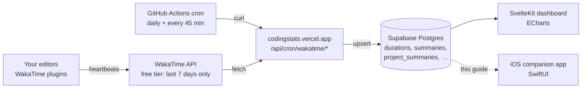

> Goal: by the end you can draw the entire system — WakaTime → crons → Supabase
> → web dashboard → iOS app — from memory, and explain *why* each hop exists.
> Every section ends with a 🗣️ **plain-English** recap; read those alone for
> the no-jargon version.

---

## What exists today

[CodingStats](https://codingstats.vercel.app) (repo: `~/code/coding-stats`) is
a **SvelteKit web dashboard** deployed on Vercel. It does one economically
clever thing and one visually pleasant thing:

1. **It rescues your data.** WakaTime's free tier only lets you query the last
   **7 days** of your coding activity. CodingStats runs scheduled jobs that
   copy each day's WakaTime data into a **Supabase Postgres** database you own.
   Data older than 7 days is gone from free WakaTime — but safe in your DB,
   forever.
2. **It visualizes it.** ECharts dashboards: total hours, daily average,
   no-code days, top project, top language, per-project drill-downs, weekly
   breakdowns, AI-vs-human line counts, and token usage.



The dashed arrow is what this guide builds.

🗣️ **In plain English.** Your code editors already report every minute you
work to a service called WakaTime. WakaTime's free plan forgets everything
after a week, so a small robot copies each day's numbers into your own
database before they vanish. A website shows charts of that database. This
guide adds a phone app that reads the same database.

---

## Why an iOS app, and why *this* iOS app

A web dashboard answers "what happened?" A phone answers a different, better
set of questions — the ones Apple Health and Apple Fitness ask about your
body, asked about your coding instead:

| Apple Fitness concept        | CodingStats iOS equivalent                                      |
| ---------------------------- | --------------------------------------------------------------- |
| Move ring / daily move goal  | **Daily coding-time goal** (e.g. 4 h/day)                       |
| Weekly exercise target       | **Weekly coding goal** (e.g. 25 h/week)                         |
| Workout time window          | **Preferred coding window** (e.g. 09:00–18:00) + % inside it    |
| Rest days                    | **Weekend / no-code days** — days you're *not* expected to code |
| Overtraining warnings        | **Burnout signals** — sustained overload, late-night drift      |
| Heart-rate zones             | **AI-usage share** — how much of your output is AI-assisted     |
| Sharing with a trainer       | **Client mode** — show a client exact hours on their project    |

Plus one feature no fitness app has: **invoicing**. Since the database knows
exactly how many seconds you spent in each project, the app can turn a date
range × hourly rate into a client-ready invoice PDF.

The app is **single-user by design**. It's your data, your phone, your auth
token. No accounts screen, no team features. That decision simplifies every
chapter that follows.

🗣️ **In plain English.** The phone app treats coding like a workout program:
you set how much you want to code, when you want to code, and which days you
rest. It cheers when you hit goals, warns when you're grinding toward
burnout, and — because it knows your hours precisely — it can also print
invoices for clients.

---

## The three layers you'll touch

Everything in this guide lives in one of three layers. Keep them straight and
nothing later will confuse you.

### Layer 1 — The producer (already built, TypeScript)

The SvelteKit app's cron endpoints, triggered by **GitHub Actions** (not
Vercel crons — a free-tier choice):

- `yesterday-crons.yaml` — daily at 01:01 UTC, hits
  `/api/cron/wakatime/{durations, durations-by-language, summaries, project-summaries}`
  to write *yesterday's* finalized numbers.
- `today-crons.yaml` — every 45 minutes, hits the same four endpoints'
  `/today` variants so *today's* partial numbers stay fresh.

Each endpoint fetches from the WakaTime API and upserts one row per day into
Supabase. You will **not** modify this layer — you'll read what it writes.

### Layer 2 — The database (already built, Postgres)

Supabase tables — the full shapes come in [Chapter 04](/04-the-data-contract/):
`durations`, `durations_by_language`, `summaries`, `project_summaries`,
`projects`, `profiles`. The pattern is *one row per day, with a `data` JSON
column holding the raw WakaTime response*. The database **is the API
contract** between web and iOS.

### Layer 3 — The consumer (this guide, Swift)

The iOS app: SwiftUI views, a thin Supabase REST client, local SwiftData
cache, goal engine, burnout analyzer, invoice generator, widgets. Chapters
05–09.

⚠️ **Gotcha for a TS dev.** There is no shared type system across layers. The
web app gets types from `supabase gen types typescript`; Swift gets nothing
automatically. The JSON inside `data` is "typed" only by convention. Chapter
04 nails down those shapes; Chapter 05 shows how to decode them defensively
with `Codable` so a WakaTime API drift doesn't crash the app.

🗣️ **In plain English.** Three pieces: a robot that writes numbers down every
day (done), the notebook it writes into (done), and the phone app that reads
the notebook (what you'll build). The phone app never talks to WakaTime
directly — it only reads the notebook.

---

## The route map for this guide

1. **Primer first** ([02](/02-swift-for-typescript-devs/), [03](/03-swiftui-xcode-primitives/)) — Swift the language, then SwiftUI/Xcode the platform. Read these even if you skim; every later chapter uses their vocabulary.
2. **Data spine** ([04](/04-the-data-contract/), [05](/05-ios-companion-architecture/)) — exact table/JSON shapes, then the app architecture that consumes them.
3. **Features** ([06](/06-windows-goals-rings/)–[09](/09-client-mode-invoicing/)) — rings & goals, burnout math, AI-usage signal, client invoicing. Each is a vertical slice: model → analysis → SwiftUI.
4. **Ship it** ([10](/10-app-store/)) — App Store bureaucracy, demystified.
5. **Practice** ([11](/11-challenges/), [12](/12-learning-resources/)) — challenges with tiered hints, then further reading.

🗣️ **In plain English.** Learn the language, learn the toolbox, learn the
data, build the app one feature at a time, then ship it to the App Store.

---

## Prove it to yourself

Before the next chapter, run these two queries against the live system and
confirm the pipeline is real:

```bash
# 1. WakaTime free tier really is 7 days — this works…
curl -s "https://wakatime.com/api/v1/users/current/summaries?start=$(date -v-6d +%F)&end=$(date +%F)" \
  -H "Authorization: Basic $(echo -n $WAKATIME_API_KEY | base64)" | head -c 300

# …but ask for 30 days back on free tier and you'll get a paywall error.

# 2. Your Supabase has data older than 7 days (replace with your project URL + anon key)
curl -s "https://<project>.supabase.co/rest/v1/summaries?select=date&order=date.asc&limit=3" \
  -H "apikey: $SUPABASE_ANON_KEY" -H "Authorization: Bearer $SUPABASE_ANON_KEY"
```

If query 2 returns dates months old, you've just proven the entire reason
this system exists.
