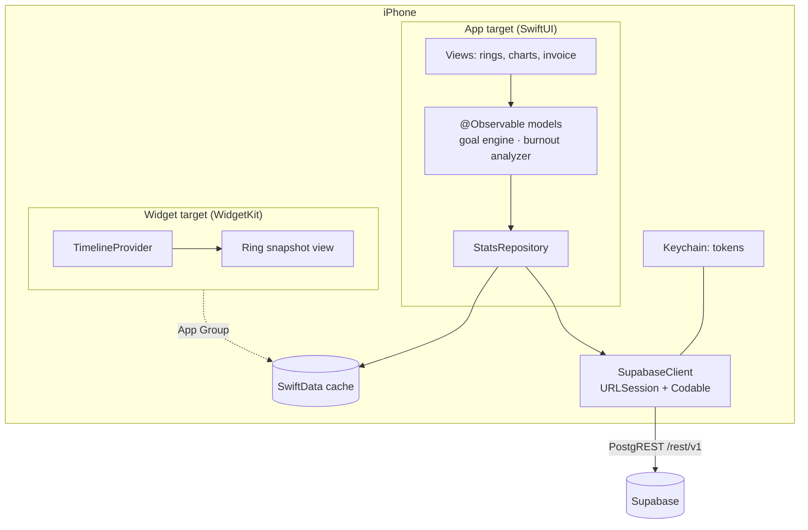

> Goal: know what every Apple noun in this guide *is* — SwiftUI, Xcode
> target, scheme, Info.plist, SwiftData, Swift Charts, WidgetKit, Keychain —
> and its closest web analogy. This chapter is a **map**, not a tutorial;
> chapters 05–09 do the building.

---

## SwiftUI: declarative UI, but compiled

SwiftUI is Apple's React/Svelte. You describe UI as a function of state; the
framework diffs and re-renders when state changes.

```swift
struct DailyRingView: View {
    let progress: Double          // 0.0 … 1.0+  — a prop
    @State private var showDetail = false   // local state — useState / $state

    var body: some View {         // body = your render function
        VStack(spacing: 12) {
            ActivityRing(progress: progress, color: .green)
            Text(progress >= 1 ? "Goal hit! 🎉" : "\(Int(progress * 100))%")
                .font(.headline)
        }
        .onTapGesture { showDetail.toggle() }
        .sheet(isPresented: $showDetail) { DetailView() }
    }
}
```

Web-dev translation table:

| SwiftUI                          | Web equivalent                                  |
| -------------------------------- | ----------------------------------------------- |
| `struct MyView: View` + `body`   | function component + JSX return                 |
| `@State`                         | `useState` / Svelte `$state`                    |
| `@Binding` (`$showDetail`)       | two-way prop — Svelte `bind:` / controlled input |
| `@Observable` model class        | MobX store / Svelte class with runes            |
| `@Environment`                   | React context                                   |
| `VStack` / `HStack` / `ZStack`   | flex column / flex row / absolute stack         |
| view *modifiers* (`.font(…)`)    | chained utility classes — Tailwind, roughly     |
| `.sheet` / `.alert`              | modal / dialog element                          |
| `NavigationStack` + `NavigationLink` | client-side router + `<a>`                  |
| `List` + `ForEach`               | `<ul>` + `.map(item => <li key=…>)`             |
| `.task { await load() }`         | `useEffect(() => { load() }, [])`               |

Two mental adjustments:

1. **No CSS.** Layout is composition (stacks, spacers, frames) and modifiers.
   The modifier *order matters*: `.padding().background(.red)` ≠
   `.background(.red).padding()` — each modifier wraps the view in a new view.
2. **Identity drives animation.** SwiftUI animates automatically when state
   changes if you ask (`withAnimation { … }`); list diffing needs
   `Identifiable` (the `key` prop lesson, enforced by the type system).

🗣️ **In plain English.** SwiftUI is the same idea as React: describe what the
screen should look like for the current data, and the framework redraws when
data changes. Styling is done by chaining little instructions onto views
instead of writing CSS.

---

## Xcode: the IDE *is* the build system

Vocabulary that has no clean web equivalent — learn these five and Xcode
stops being scary:

- **Project (`.xcodeproj`)** — the workspace + build config. Unlike
  `package.json`, it's a binary-ish file Xcode edits for you. (Modern option:
  keep code in a **Swift Package** and let the project be a thin shell.)
- **Target** — one buildable product. The app is a target; the widget
  extension is a second target; the test bundle a third. ≈ entries in a
  monorepo's `turbo.json` — each with its own dependencies and build settings.
- **Scheme** — "which target(s) to build and how to run them" — ≈ npm script
  (`dev`, `test`, `build:release`).
- **Info.plist** — app metadata: display name, bundle ID
  (`com.cesarnml.codingstats`), permission-prompt strings. ≈ web app manifest.
- **Simulator** — run iOS on your Mac. ≈ browser devtools device mode, except
  it's the real OS.
- **Signing & capabilities** — cryptographic identity + entitlement flags
  (App Groups, Keychain sharing). No web equivalent; Chapter 10 demystifies.

CLI folks: `xcodebuild` scripts everything, and `xcrun simctl` drives
simulators headlessly — CI is possible without clicking.

🗣️ **In plain English.** Xcode is editor, bundler, dev-server, and app-signer
in one. A "target" is a thing it can build (app, widget, tests); a "scheme"
is a recipe for building and running one; Info.plist is the app's ID card.

---

## The frameworks this app uses, one paragraph each

### Foundation — the standard library+
`Date`, `Calendar`, `DateComponents`, `URLSession`, `JSONDecoder`,
`FileManager`, `Locale`. **`Calendar` will matter more than you expect**:
"which day did this session belong to," "is this a weekend," and "what's the
start of the user's Monday" are calendar math, time-zone sensitive, and the
source of every off-by-one bug in fitness apps. Respect it early.

### URLSession — your `fetch`
`try await URLSession.shared.data(for: request)` ≈ `await fetch(url)`. Plus
free HTTP/2, caching policies, and background transfers. The app's entire
network layer is ~100 lines on top of this (Chapter 05).

### Codable — your zod
Declare `struct Summary: Codable` and the compiler writes the JSON
(de)serializer. Custom `CodingKeys` map WakaTime's `snake_case` to Swift's
`camelCase`. Decoding failures are typed errors, not `undefined`s that
explode three screens later.

### SwiftData — your local database (Room/Prisma for iOS)
Annotate a class with `@Model` and you get persistence, migrations, and
`@Query` — a SwiftUI property wrapper that live-updates views when the
database changes (feels like a Supabase realtime subscription, but local).
This is the offline cache for all synced stats (Chapter 05).

### Swift Charts — your ECharts
Declarative charts in SwiftUI: `Chart { BarMark(x:…, y:…) }`. Everything the
web dashboard renders with ECharts, the phone renders with Swift Charts —
bar, line, area, point, and (with two `SectorMark`s) the activity rings.

### WidgetKit — home-screen widgets
A widget is a **separate process** that renders a SwiftUI *timeline* of
snapshots — think static site generation for UI: you pre-render entries, the
OS displays them on schedule. The "today's ring" widget is the app's killer
feature and gets a challenge in Chapter 11. Data is shared with the app via
an **App Group** container.

### Keychain — your secrets store
The Supabase anon key ships in the binary (it's public by design; RLS is the
gate — Chapter 04), but the *user JWT / service token* lives in Keychain, the
OS-encrypted secret store. ≈ httpOnly cookie in spirit: secrets survive
reinstalls and never sit in plaintext.

### UserNotifications — local nudges
"You're 40 minutes from your daily goal" or "It's 11 pm — this is your third
late-night session this week." All computed **on device** and scheduled as
local notifications; no push server needed for a single-user app.

### StoreKit — skipped, deliberately
Single-user personal app: no in-app purchases. StoreKit only shows up in
Chapter 10 as "things App Review checks that you *don't* have."

🗣️ **In plain English.** Apple ships a toolbox: one tool talks to the
internet, one turns JSON into Swift objects, one stores data on the phone,
one draws charts, one puts a mini-view on the home screen, one keeps secrets
safe, one sends reminders. The app is these seven tools plus your logic.

---

## How the pieces stack



Keep this diagram; Chapter 05 fills in every box.

---

## Prove it to yourself

Fifteen minutes, no reading ahead:

1. Xcode → New Project → iOS App (SwiftUI). Name: `CodingStatsFitness`.
2. Replace `ContentView` with the `DailyRingView` above; stub
   `ActivityRing` as `Circle().trim(from: 0, to: progress).stroke(color, lineWidth: 16).rotationEffect(.degrees(-90))`.
3. Run in the simulator (⌘R). Tap the ring — the sheet appears.
4. Say out loud what `@State`, the scheme dropdown, and the simulator each
   correspond to in your web stack. If you can, this chapter did its job.
