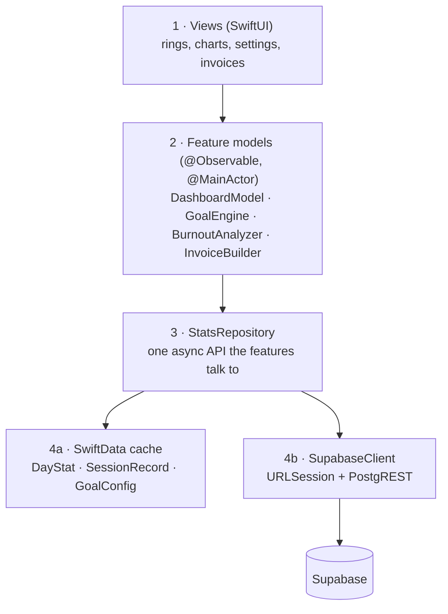

> Goal: hold the whole app in your head as five layers, know what each owns,
> and understand the one non-obvious decision (cache-forever-except-today)
> that makes the app feel instant and work offline.

---

## The five layers



**Dependency rule:** arrows only point down. Views never import the network
client; the analyzer never knows JSON exists. Every layer is testable by
faking the one below it (protocols, Chapter 02).

🗣️ **In plain English.** The app is a stack of five floors: screens on top,
then feature brains, then a librarian, then (side by side) a filing cabinet
on the phone and a phone line to the database. Each floor only talks to the
floor directly below.

---

## Layer 4b — SupabaseClient (~100 lines, no SDK)

A thin, honest wrapper over PostgREST. No official SDK needed for read-heavy,
single-user use:

```swift
struct SupabaseClient {
    let baseURL: URL          // https://<project>.supabase.co/rest/v1
    let apiKey: String        // anon key — public by design
    var session: URLSession = .shared

    func rows<T: Decodable>(
        _ table: String, select: String = "date,data",
        from: DateOnly? = nil, to: DateOnly? = nil, as type: T.Type
    ) async throws -> [T] {
        var comps = URLComponents(url: baseURL.appending(path: table), resolvingAgainstBaseURL: false)!
        var items = [URLQueryItem(name: "select", value: select),
                     URLQueryItem(name: "order", value: "date.asc")]
        if let from { items.append(.init(name: "date", value: "gte.\(from)")) }
        if let to   { items.append(.init(name: "date", value: "lte.\(to)")) }
        comps.queryItems = items

        var req = URLRequest(url: comps.url!)
        req.setValue(apiKey, forHTTPHeaderField: "apikey")
        req.setValue("Bearer \(apiKey)", forHTTPHeaderField: "Authorization")

        let (data, resp) = try await session.data(for: req)
        guard (resp as? HTTPURLResponse)?.statusCode == 200 else { throw ApiError.badStatus }
        return try JSONDecoder.wakatime.decode([T].self, from: data)
    }
}
```

The `Codable` models mirror Chapter 04's shapes — decoded defensively:

```swift
struct SummaryRow: Decodable {
    let date: DateOnly
    let data: DaySummary?          // optional: a bad day decodes to nil, not a crash
}

struct DaySummary: Decodable {
    struct GrandTotal: Decodable { let totalSeconds: Double }
    struct Category: Decodable { let name: String; let totalSeconds: Double }
    let grandTotal: GrandTotal?
    let categories: [Category]?
    // CodingKeys map snake_case → camelCase via .convertFromSnakeCase
}
```

⚠️ **Two Foundation gotchas worth pre-solving:**
- Make a `DateOnly` type (year-month-day, no time zone) for `date` columns.
  Parsing `"2026-07-05"` into a `Date` invites the classic off-by-one-day
  bug when the phone isn't in UTC.
- Session `time` fields are Unix epoch *doubles* — decode as `Double`, convert
  with `Date(timeIntervalSince1970:)`, and always interpret via the user's
  `Calendar`/`TimeZone`, not UTC.

🗣️ **In plain English.** One small component builds the web request, adds
the key, downloads the JSON, and unpacks it into Swift objects — carefully,
so one bad day of data gets skipped instead of crashing the app.

---

## Layer 4a — SwiftData cache: the offline heart

Chapter 04's asymmetry (**past rows immutable, today's row hot**) becomes
three `@Model` classes:

```swift
@Model final class DayStat {                 // from summaries
    @Attribute(.unique) var date: String     // "2026-07-05"
    var totalSeconds: Double
    var aiSeconds: Double                    // categories["AI Coding"]
    var byCategory: [String: Double]
    var rawJSON: Data                        // keep the original — re-parse without re-download
    var isFinalized: Bool                    // false only for today
}

@Model final class SessionRecord {           // from durations — powers window/burnout math
    var start: Date
    var seconds: Double
    var project: String
    var dateKey: String                      // denormalized "which day" in user's tz
}

@Model final class GoalConfig {              // user settings — Chapter 06
    var dailyGoalMinutes: Int
    var weeklyGoalMinutes: Int
    var windowStartMinute: Int               // 540 = 09:00
    var windowEndMinute: Int                 // 1080 = 18:00
    var restDays: [Int]                      // weekday numbers, e.g. [1, 7] = Sun/Sat
    var hourlyRates: [String: Decimal]       // per-project — Chapter 09
}
```

Views query it live — SwiftData's `@Query` re-renders on change, like a local
realtime subscription:

```swift
struct HistoryView: View {
    @Query(sort: \DayStat.date, order: .reverse) private var days: [DayStat]
    var body: some View { List(days) { DayRow($0) } }
}
```

🗣️ **In plain English.** The phone keeps its own copy of every day's numbers
in a small on-device database. Screens read from that copy — which is why the
app opens instantly and works on airplane mode — and the copy quietly updates
itself when online.

---

## Layer 3 — StatsRepository: the sync brain

One type owns the cache-vs-network decision; nothing above it knows syncing
exists:

```swift
@MainActor
final class StatsRepository {
    // The strategy, verbatim from the data contract:
    // 1. Cold start: backfill month-by-month until Supabase returns empty (history is finite).
    // 2. Every foreground/refresh: refetch ONLY today + any non-finalized days.
    // 3. At local midnight: yesterday flips to finalized after the 01:01 UTC cron
    //    → one last refetch of that date, then it's immutable forever.
    func syncIfNeeded() async
    func daySummaries(_ range: ClosedRange<DateOnly>) -> [DayStat]   // cache-only reads
    func sessions(on day: DateOnly) -> [SessionRecord]
}
```

Triggers: app launch, `.scenePhase` foreground change, pull-to-refresh, and a
`BGAppRefreshTask` so the widget stays fresh without opening the app.

**Full offline story falls out for free:** reads never block on network;
sync failures just leave `lastSyncError` for a banner; the only permanently
network-dependent value is *today so far*, clearly labeled "as of 12:41."

🗣️ **In plain English.** A librarian sits between screens and the internet.
Screens always ask the librarian, who answers instantly from local files and
separately keeps those files up to date — refetching only today's page,
because finished days never change.

---

## Layer 2 — Feature models

Each feature is an `@Observable @MainActor` class taking the repository (as a
protocol) in its initializer — the app's business logic, fully unit-testable
with a fixture repository, no simulator needed:

| Model              | Owns                                                        | Chapter |
| ------------------ | ----------------------------------------------------------- | ------- |
| `DashboardModel`   | load states for the home screen                             | 06      |
| `GoalEngine`       | ring progress, streaks, window-adherence %                  | 06      |
| `BurnoutAnalyzer`  | rolling loads, late-night drift, rest-day violations        | 07      |
| `AiUsageModel`     | AI-share trends                                             | 08      |
| `InvoiceBuilder`   | project hours × rate → PDF                                  | 09      |

## Layer 1 — Views

```
CodingStatsFitnessApp
└─ TabView
   ├─ Today       — rings, window gauge, streak        (06)
   ├─ Trends      — charts, burnout panel, AI share    (07–08)
   ├─ Projects    — per-project stats → invoice flow   (09)
   └─ Settings    — goals, window, rest days, rates    (06)
+ WidgetKit extension — today's ring on the home screen (11)
```

---

## Project layout

```
CodingStatsFitness/
├── App/                    # @main, TabView, DI wiring
├── Features/               # one folder per feature: views + its model
│   ├── Today/  Trends/  Projects/  Invoices/  Settings/
├── Data/
│   ├── Remote/             # SupabaseClient, DTOs (Codable)
│   ├── Local/              # SwiftData @Models
│   └── StatsRepository.swift
├── Core/                   # DateOnly, Calendar helpers, formatting
└── Widgets/                # widget extension target
```

The one rule that keeps it clean: **DTOs (`Remote/`) and cache models
(`Local/`) are different types.** DTOs mirror WakaTime's JSON quirks; cache
models mirror what features need. The repository maps between them — ugly
JSON stays quarantined at the boundary, exactly like keeping API types out
of your components in a web app.

---

## Prove it to yourself

Wire the thinnest possible spike — no SwiftData, no goals: `SupabaseClient`
+ `SummaryRow` + a `List` showing the last 14 days as `"2026-07-05 — 5h 39m"`.
If that renders on the simulator, layers 4b→1 all work, and everything else
in this guide is refinement. (Stuck? Challenge 1 in [Chapter 11](/11-challenges/)
has tiered hints for exactly this spike.)
