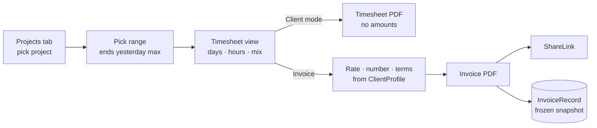

> Goal: build the two client-facing features — a read-only per-project hours
> view you can show (or send) to a client, and an `InvoiceBuilder` that turns
> a project × date-range × rate into a professional PDF.

---

## Why this feature earns its place

The same property that makes the data good for fitness makes it good for
billing: **it's collected passively and continuously**. No timers to start,
no end-of-month reconstruction from memory. When a client asks "what did I
get for those 12 hours?", the honest answer is already in
`project_summaries` — day by day, with language and branch breakdowns.

Two distinct deliverables, sharing one engine:

1. **Client mode** — a clean per-project report screen: hours per day/week,
   category mix, total for a range. Show it across a table, or export as PDF
   *without* amounts — a **timesheet**, for transparency without a bill.
2. **Invoice** — timesheet × hourly rate + identity/numbering/terms —
   a **bill**, as PDF via the share sheet.

🗣️ **In plain English.** Your database already knows exactly which hours
went to which client's project. This chapter turns that into two documents:
a "here's where the time went" report, and a proper invoice with your rate
applied.

---

## The data: what to sum, and the rounding policy

Hours come from `project_summaries` ([Chapter 04](/04-the-data-contract/)) —
one row per day, per-project grand totals inside `data`:

```
billableSeconds(project, range) = Σ over days in range of
    projectSummary[day][project].grand_total.total_seconds
```

⚠️ **Policy decisions to make once, deliberately, and print on the invoice:**

- **Rounding.** Raw seconds → billed time needs a declared rule. Common and
  defensible: round *the period total* (not each day) up to the nearest
  0.25 h. Per-day rounding compounds in your favor and clients notice —
  it's how trust dies.
- **Tracked ≠ contracted.** WakaTime measures editor-active time; thinking,
  calls, and reviews aren't in it. The invoice footer should say what the
  numbers are: *"Hours are editor-tracked development time."* Undersell,
  overdeliver.
- **The today problem.** Today's row is still mutating
  ([Chapter 04](/04-the-data-contract/)) — invoice ranges should end
  **yesterday or earlier**. The UI simply doesn't offer today as a range end.

Rates and invoice records live locally (single-user app — the phone is the
office):

```swift
@Model final class ClientProfile {           // attach projects to a client
    var name: String
    var projects: [String]                   // WakaTime project names
    var hourlyRate: Decimal                  // Decimal, never Double, for money!
    var currencyCode: String                 // "USD"
}

@Model final class InvoiceRecord {           // issued = immutable snapshot
    var number: String                       // "CS-2026-014"
    var clientName: String
    var range: String
    var lineItems: Data                      // frozen JSON — NOT recomputed later
    var totalBilled: Decimal
    var issuedAt: Date
    var pdf: Data                            // the exact bytes you sent
}
```

**Issued invoices are snapshots, not queries.** If a cron backfills data
later, invoice CS-2026-014 must still say what it said when you sent it —
store the line items *and the PDF bytes*.

Money is `Decimal` + `Locale`-aware formatting (`Decimal.FormatStyle.Currency`)
— the floating-point lesson every web dev already learned once, enforced by
type choice.

🗣️ **In plain English.** Add up the project's seconds in the date range,
round the total (not each day) up to the nearest quarter-hour, multiply by
your rate. Say on the invoice exactly what was measured. And once an invoice
is sent, it's frozen — the app keeps the exact PDF, even if the underlying
data shifts later.

---

## Building the PDF

No library needed — render SwiftUI straight to paper via `ImageRenderer`:

```swift
@MainActor
func renderInvoicePDF(_ invoice: InvoiceModel) -> Data {
    let letter = CGRect(x: 0, y: 0, width: 612, height: 792)   // 8.5"×11" @72dpi
    let renderer = ImageRenderer(content: InvoicePage(invoice: invoice)
        .frame(width: letter.width, height: letter.height))

    let data = NSMutableData()
    renderer.render { size, render in
        var box = letter
        guard let ctx = CGContext(consumer: CGDataConsumer(data: data)!,
                                  mediaBox: &box, nil) else { return }
        ctx.beginPDFPage(nil)
        render(ctx)
        ctx.endPDFPage()
        ctx.closePDF()
    }
    return data as Data
}
```

`InvoicePage` is just a SwiftUI view — the same skill as the rest of the
app: header (your name ← `profiles`), client block, line-item `Grid`, totals
right-aligned, terms footer. Multi-page = paginate line items into chunks
and call `beginPDFPage` per chunk. A `PDFKit.PDFView` wrapped in
`UIViewRepresentable` gives in-app preview before sending.

Web analogy: this is the "render an HTML template to PDF" trick, except the
template language is SwiftUI and the browser is a `CGContext`.

### Sharing — the last ten lines

```swift
ShareLink(item: invoicePDFURL,
          preview: SharePreview("Invoice \(invoice.number)", icon: Image(systemName: "doc.text")))
```

`ShareLink` hands the PDF to Mail/Messages/AirDrop/Files. Write the bytes to
a temp URL named properly — `CS-2026-014.pdf` — because that filename is
what lands in the client's inbox.

🗣️ **In plain English.** The invoice is drawn with the same UI toolkit as
the rest of the app, printed into a PDF by the system, previewed in-app, and
sent with the standard iOS share sheet — attach to email, AirDrop, save to
Files.

---

## The flow, end to end



Invoice numbers auto-increment per year (`CS-2026-001`, `-002`, …) — a
`max + 1` over `InvoiceRecord`; never reuse or reorder issued numbers.

---

## Prove it to yourself

Unit-test the engine's three trust-critical properties:

1. **Rounding is total-level:** 5 days × 1 h 7 min → billed `5.75 h`
   (total 5:35 → next quarter), *not* `6.25 h` (per-day roundups).
2. **Range immutability:** build an invoice, mutate the underlying
   `DayStat`s, re-open the `InvoiceRecord` → identical line items and bytes.
3. **Money formatting:** `Decimal(137.5) × rate 120` formats as `$16,500.00`
   under `en_US` and `16.500,00 US$` under `es_ES` — locale handled by the
   formatter, never by string math.

Then do the honest end-to-end: generate a real invoice for last month's
biggest project and AirDrop it to yourself. If you'd send that PDF to a
client, ship it.
