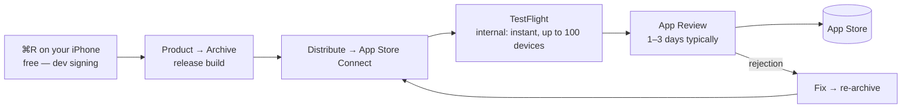

> Goal: lose your fear of Apple's distribution bureaucracy. It's four
> concepts, one pipeline, and a short list of review rules that actually
> apply to this app.

---

## The four nouns of code signing

Everything confusing about iOS distribution is these four things wearing
trench coats:

1. **Developer account** — $99/year, personal is fine. Web analogy: your
   Vercel account, except it also notarizes your identity to Apple.
2. **Certificate** — a public/private keypair proving *you* built the
   binary. Lives in your Mac's Keychain. ≈ your SSH key for deploys.
3. **App ID / bundle ID** — `com.cesarnml.codingstatsfitness`, plus its
   **capabilities** (App Groups for the widget ← [Chapter 05](/05-ios-companion-architecture/)).
   ≈ the domain name of your app.
4. **Provisioning profile** — the document tying 1+2+3 together with a
   device list (dev) or the App Store (distribution). The thing that
   mysteriously "expires"; ≈ a signed deploy token.

**The escape hatch that makes this bearable:** Xcode → Signing & Capabilities
→ **"Automatically manage signing."** For a solo developer it genuinely
works — Xcode creates and renews all four nouns. You need the vocabulary
only for the day an error message uses it.

🗣️ **In plain English.** Apple wants cryptographic proof of who built every
app. You buy an identity, Xcode generates keys and paperwork tying your app
to it, and checking one box makes Xcode do all of it automatically. Learn
the four words so the error messages aren't scary; let the checkbox do the
work.

---

## The pipeline: from ⌘R to the store

- **Run on your own iPhone today**: plug in, select device, ⌘R. First run:
  trust the developer cert on the phone (Settings → General → VPN & Device
  Management). You could stop here — a single-user app on your own phone is
  a legitimate endpoint — but TestFlight builds expire after 90 days and
  personal-team dev builds after 7, so **the store is how the app stays
  installed without a leash to Xcode**. That's the real reason to finish
  this chapter.
- **App Store Connect** is the web console (appstoreconnect.apple.com):
  metadata, screenshots, TestFlight, review submission. ≈ the Vercel
  dashboard to Xcode's CLI.
- **TestFlight internal testing** needs no review and lands on your phone
  minutes after upload — it's your staging environment. Use it for a week
  before submitting; you'll find the sync bugs reviewers would.

🗣️ **In plain English.** Archive is the production build; App Store Connect
is the dashboard; TestFlight is staging on your real phone; then a human at
Apple checks it and it goes live — where it finally runs forever without
needing your Mac.

---

## App Review for *this* app: the honest checklist

Most of the review guidelines don't apply to a stats viewer. The ones that
do:

| Guideline area                | What it means here                                                                                                                                       |
| ----------------------------- | --------------------------------------------------------------------------------------------------------------------------------------------------------- |
| **4.2 Minimum functionality** | The biggest real risk. A web-view wrapper gets rejected; this app is native SwiftUI with offline cache, widgets, notifications, and PDF export — say so in review notes. |
| **2.1 App completeness**      | No placeholder screens; empty states must look intentional (the cold-start "calibrating" states from Chapters 06–07 count).                                |
| **Demo account**              | Reviewers must see real UI. Options: ship a **demo mode** (fixture repository behind a Settings toggle — you already built it for previews, Chapter 05) — this is the standard solo-dev answer. |
| **5.1 Privacy**               | The nutrition label: data collected = coding activity, linked to you, not used for tracking. No third-party analytics in the app = the easy label. A privacy policy URL is required — a page on codingstats.vercel.app works. |
| **3.1 Payments**              | Invoicing PDFs are fine — the app *generates documents*, it doesn't process payments. No IAP needed for a free app.                                        |
| **Widgets**                   | Must show meaningful content immediately — placeholder timeline entries matter (Chapter 11's widget challenge covers this).                                |

**Pricing reality check:** Free, no IAP, is the right call — the "customer"
already owns the backend. Paid/freemium would add tax forms, banking
paperwork, and review scrutiny for zero upside on a single-user tool.

⚠️ **The one non-obvious trap:** hardcoding *your* Supabase URL/anon key
makes the app useless to anyone else — which collides with 4.2's spirit
("apps should be useful to the general public"). The demo mode doubles as
the answer: reviewer sees a fully working app with sample data; the Settings
screen accepts a custom Supabase URL + key for the (rare) other user with
their own CodingStats deployment. Two birds, one toggle — and the app is
honestly describable as "bring your own backend."

🗣️ **In plain English.** Apple's reviewers mainly check that the app isn't
an empty shell, that they can actually see it work, and that you disclose
what data it touches. The built-in sample-data mode answers all three at
once — reviewers get a working tour, and other people can point the app at
their own database.

---

## Release cadence for a solo app

- **Versioning:** marketing version (`1.0`, `1.1`) + build number that only
  goes up. Xcode Cloud or a two-line script can bump builds; don't overthink.
- **Phased release:** irrelevant at N=1 users; turn it off.
- **Updates re-enter review** (usually faster). Batch small fixes.
- **Crash reports & TestFlight feedback** arrive in App Store Connect →
  a solo dev's entire observability stack, and honestly enough.

---

## Prove it to yourself

Do the pipeline once with a walking skeleton — *before* the app is finished
(pipeline bugs are the worst bugs to discover last):

1. Archive the Chapter 05 spike (`Product → Archive`).
2. Upload to App Store Connect; add yourself as an internal TestFlight
   tester; install on your phone from the TestFlight app.
3. Fill in the privacy nutrition label draft while you're in the console.

The whole loop is ~an hour the first time. Once it's boring, shipping the
real thing is a formality.
